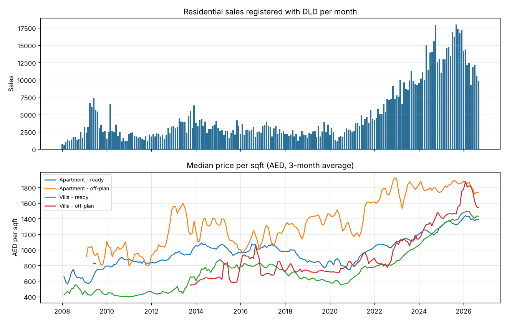
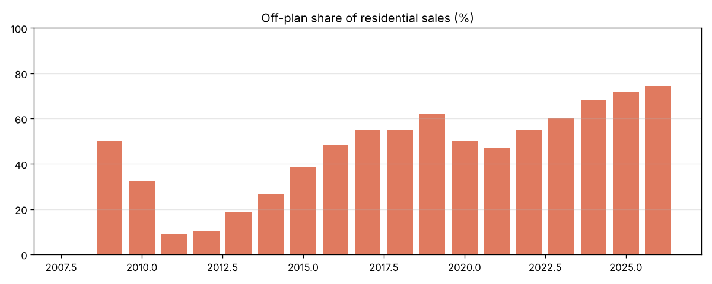
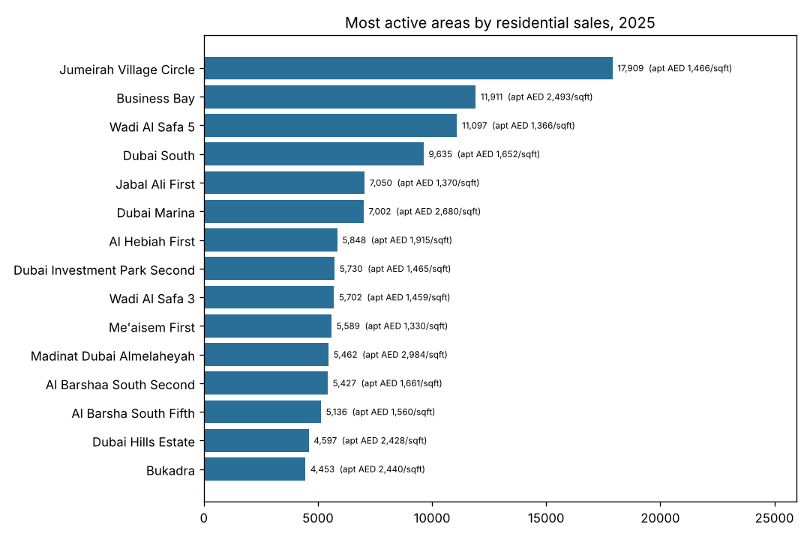
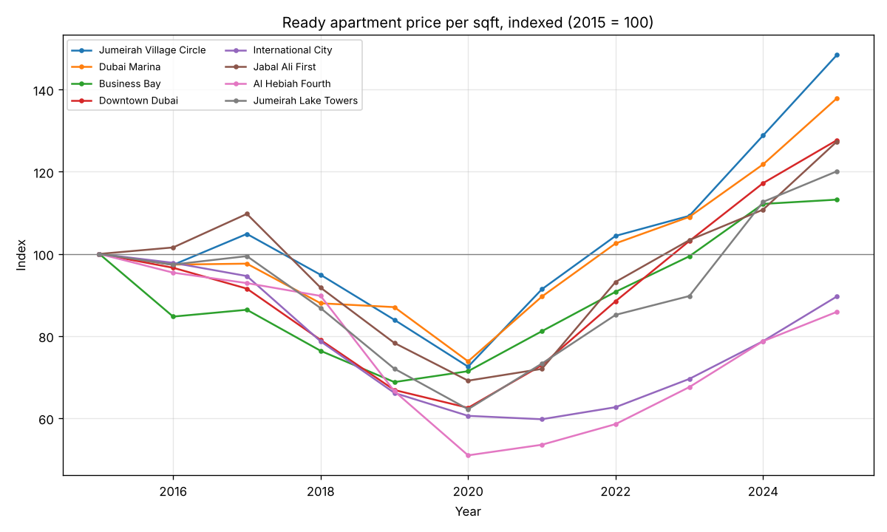
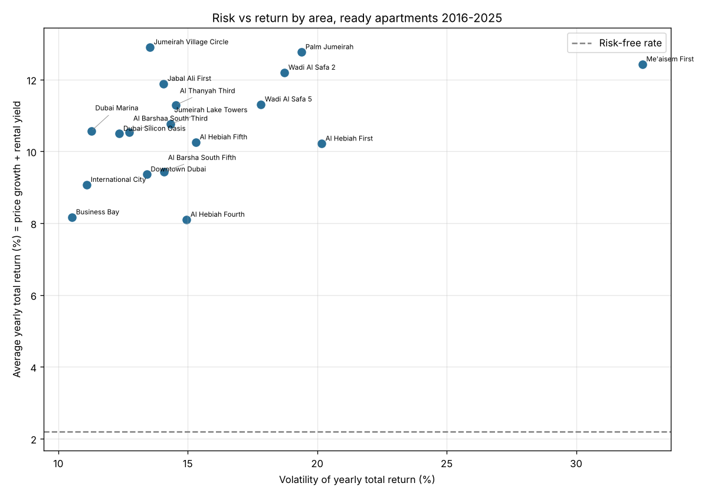
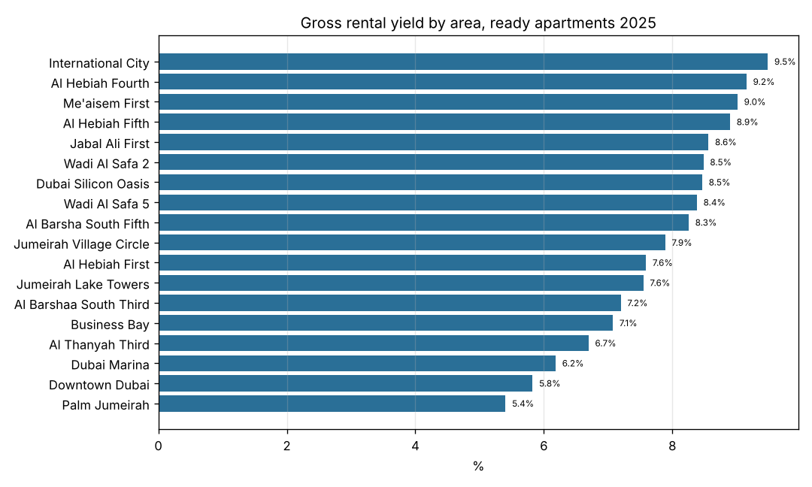
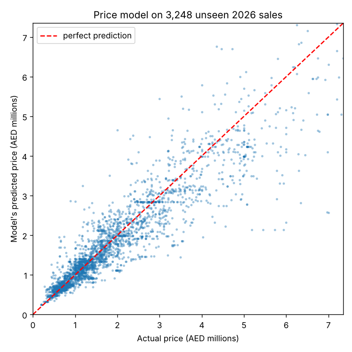

# Dubai Real Estate Investment Analysis

**Which Dubai neighbourhoods give investors the best return for the risk they take?**

This project analyses Dubai residential property the way an investment analyst would, using **official Dubai Land Department (DLD) data only**: every registered residential sale since 2008 and every Ejari rent contract since 2010. For each area it measures price growth, rental yield, volatility and risk-adjusted return (Sharpe ratio). It also trains a machine-learning model that estimates property prices and flags sales that look underpriced.

**Tools:** Python · pandas · scikit-learn · matplotlib · Streamlit · Plotly

| Data | Size | Source |
|---|---|---|
| Residential sales, 2008 – 15 Oct 2026 | 1.09 million sales | [DLD Real Estate Transactions](https://data.dubai/en/l/470061) on Data Dubai |
| Residential rent contracts, 2010 – 2026 | 5.5 million contracts | [DLD Rent Contracts (Ejari)](https://data.dubai/en/l/468586) on Data Dubai |

---

## 1. Market overview



| Year | Residential sales | Value (AED bn) | Off-plan share |
|---|---|---|---|
| 2015 | 31,902 | 51.6 | 38% |
| 2020 | 26,410 | 39.2 | 50% |
| 2023 | 108,210 | 234.1 | 60% |
| 2024 | 154,503 | 319.5 | 68% |
| 2025 | 181,818 | 390.1 | 72% |
| 2026 (Jan–Sep) | 106,780 | 221.0 | 75% |

**What the data shows**

1. **A full boom-bust-boom cycle.** Median ready-apartment prices fell about 22% from 2015 to 2020 (AED ~1,000 to ~780 per sq ft). They then rose about 73% to ~1,350 by 2025.
2. **Volumes are at record levels, driven by off-plan.** In 2025 there were 181,818 residential sales, almost 7 times the 2020 level. 72% were off-plan homes bought from developers before completion, up from 38% in 2015.
3. **2026 is cooling.** Sales from January to September 2026 are 18% below the same months of 2025, and monthly sales have dropped from ~17,000 in late 2025 to ~10,000. Ready apartment prices have flattened at ~AED 1,400 per sq ft.
4. **The most active areas are new mid-market communities.** Jumeirah Village Circle led 2025 with 17,909 sales, followed by Business Bay, Wadi Al Safa 5 and Dubai South.




> DLD records use official land-registry names, which often differ from everyday names. For example, *Marsa Dubai* is Dubai Marina and *Al Barsha South Fourth* is JVC. Charts show the common name where the match is well established (see `src/area_labels.py`).

---

## 2. Risk and return by area (ready apartments, 2015–2025)

Only areas with **50+ ready apartment sales and 100+ new rent contracts in every year** from 2015 to 2025 are included (18 areas). This keeps every number based on large samples.

| Area | AED/sqft 2025 | Price growth / yr (10y) | Price growth / yr (last 5y) | Gross yield 2025 | Avg total return / yr | Volatility | Sharpe |
|---|---|---|---|---|---|---|---|
| Jumeirah Village Circle | 1,274 | 4.0% | 15.4% | 7.9% | 12.9% | 13.5% | 0.79 |
| Dubai Marina | 1,900 | 3.3% | 13.3% | 6.2% | 10.6% | 11.3% | 0.74 |
| Jabal Ali First | 1,040 | 2.4% | 13.0% | 8.6% | 11.9% | 14.1% | 0.69 |
| Dubai Silicon Oasis | 899 | 1.1% | 10.2% | 8.5% | 10.5% | 12.4% | 0.67 |
| Al Barshaa South Third | 1,284 | 2.1% | 9.6% | 7.2% | 10.5% | 12.7% | 0.65 |
| Al Thanyah Third | 1,738 | 2.7% | 15.6% | 6.7% | 11.3% | 14.5% | 0.63 |
| International City | 629 | -1.1% | 8.1% | 9.5% | 9.1% | 11.1% | 0.62 |
| Jumeirah Lake Towers | 1,420 | 1.8% | 14.1% | 7.6% | 10.8% | 14.3% | 0.60 |
| Business Bay | 1,778 | 1.2% | 9.6% | 7.1% | 8.2% | 10.5% | 0.57 |
| Palm Jumeirah | 2,563 | 4.8% | 20.2% | 5.4% | 12.8% | 19.4% | 0.54 |
| Downtown Dubai | 2,539 | 2.5% | 15.3% | 5.8% | 9.4% | 13.4% | 0.53 |

*Top 11 of 18 areas by Sharpe ratio. The full table is in `data/processed/area_metrics.csv`.*

**What the data shows**

1. **Rental income did most of the work.** Over 10 years, prices grew only −1.5% to +4.8% a year because the 2015–2020 fall cancelled much of the later rise. Gross yields of 5.4–9.5% made up most of the total return.
2. **Cheaper areas yield more.** International City (9.5%) and Dubai Silicon Oasis (8.5%) have the highest yields. Palm Jumeirah (5.4%) and Downtown (5.8%) have the lowest, but the strongest recent price growth.
3. **JVC and Dubai Marina had the best return for the risk.** JVC combined a high yield with strong growth. Dubai Marina had one of the steadiest price paths. Palm Jumeirah had high returns but also the highest volatility of the prime areas.
4. **Every area beat cash.** All 18 areas averaged 8–13% a year before costs, well above the ~2.2% risk-free rate.





---

## 3. Price model and value finder

A gradient-boosting model predicts a home's price from its area, type, size, bedrooms, off-plan status and sale date. It is trained on 2023–2025 sales and **tested on 2026 sales it has never seen**. This "out-of-time" test is harder than a random split, because the model has to predict the future.

| Test on 3,248 unseen 2026 sales | Result |
|---|---|
| R² (log price) | 0.91 |
| Median error | 11.6% |
| Predictions within ±20% | 71% |

The value finder flags 2026 sales priced 20–50% below the model's estimate: 341 sales, or 10%. These are leads to research, not recommendations. A larger gap usually means a non-market deal, such as a partial-share transfer, so those are excluded.



---

## Methodology

| Metric | How it's calculated |
|---|---|
| Price per sqft | Median of (price ÷ size) for ready apartment sales, per area per year |
| Price growth | (2025 median ÷ 2015 median)^(1/10) − 1; last 5 years uses 2020 → 2025 |
| Gross rental yield | Median annual rent per sqft (new Ejari contracts) ÷ median sale price per sqft |
| Total return (year t) | Price change in year t + rental yield from year t−1 |
| Volatility | Standard deviation of yearly total return |
| Sharpe ratio | (Average total return − 2.2% risk-free rate) ÷ volatility |

**Why ready apartments and price per sqft?** Off-plan launches change the mix of what sells each year. Comparing ready homes per sq ft keeps the comparison like-for-like.

**Cleaning rules** (`src/build_dataset.py`):

- Sales: residential flats and villas only, AED 100–20,000 per sq ft.
- Rents: residential contracts covering a single property, AED 5–1,000 per sq ft per year.

**Limitations**

- Gross yield ignores service charges, vacancy, fees and mortgage costs.
- Total return is a simple sum, not an IRR.
- Medians can still move when the type of home sold in an area changes.
- Recent months may rise slightly as late registrations are added.
- The risk-free rate is an approximate 2016–2025 average of 3-month US T-bills (the AED is pegged to the USD).

---

## Project structure

```
dubai-real-estate/
├── app.py                          # Interactive Streamlit dashboard
├── data/
│   ├── raw/                        # 1,500-row samples of the official files (full files go here too)
│   └── processed/                  # Small summary files built from the full DLD data
│       ├── sales_by_area_year.csv  # Sales: year × area × type × ready/off-plan
│       ├── rents_by_area_year.csv  # Rents: year × area × type × new/renewal
│       ├── monthly_market.csv      # City-wide monthly sales, value, AED/sqft
│       ├── sales_sample.csv        # Random 3% of 2023+ sales (for the price model)
│       ├── area_metrics.csv        # Output: risk/return per area
│       ├── top_areas.csv           # Output: most active areas
│       └── possible_undervalued_deals.csv  # Output: value finder
├── images/                         # Charts used in this README
├── src/
│   ├── build_dataset.py            # Turns the official DLD downloads into data/processed/
│   ├── market_overview.py          # Section 1
│   ├── analysis.py                 # Section 2: growth, yield, risk, Sharpe
│   ├── model.py                    # Section 3: price model + value finder
│   └── area_labels.py              # DLD area name → common name
└── requirements.txt
```

## How to run

```bash
git clone https://github.com/ShaikhaKhaledAlz/dubai-real-estate.git
cd dubai-real-estate
pip install -r requirements.txt

python src/market_overview.py   # market charts
python src/analysis.py          # risk/return table + charts
python src/model.py             # price model + value finder
streamlit run app.py            # dashboard in your browser
```

The processed data is already in the repo, so these run straight away.

## Updating with the latest DLD data

1. Download the CSV parts of [Real Estate Transactions](https://data.dubai/en/l/470061) (~1.1 GB) and [Rent Contracts](https://data.dubai/en/l/468586) (~5 GB) from Data Dubai. Put them in `data/raw/`. They are git-ignored.
2. Run `python src/build_dataset.py` to rebuild `data/processed/`, then rerun the scripts above.
3. To test the pipeline without downloading anything, run `python src/build_dataset.py --test`. It uses the samples in `data/raw/`.

## Next steps

- Net yield after service charges (DLD Mollak data) and a full IRR with mortgage leverage
- Repeat-sales price index (same unit sold twice) to remove mix effects completely
- Compare with Abu Dhabi and other Gulf markets; add macro drivers (rates, oil, population)

---

*Built by Shaikha as a portfolio project in data analysis and investment research. Data © Dubai Land Department, published on Data Dubai under its open data licence.*
